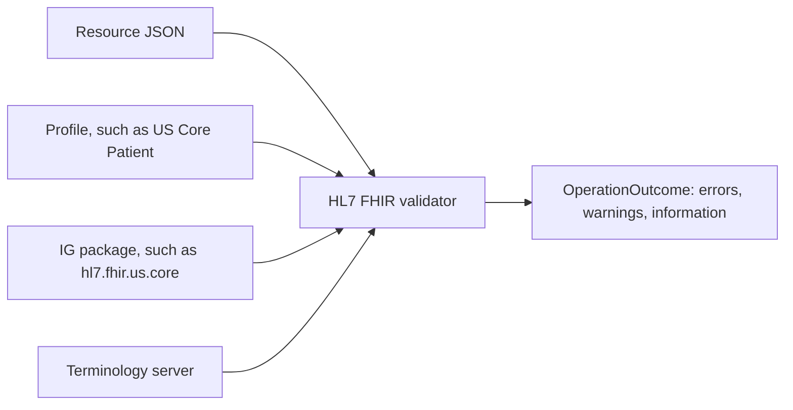

# Module 4: Profiles, extensions and terminology

Specification to check against: https://hl7.org/fhir/R4/profiling.html,
https://hl7.org/fhir/R4/extensibility.html and https://hl7.org/fhir/R4/terminologies.html

## Concepts

### Why profiles exist

Module 2 said most elements in the base specification are optional, and module 1 said an
implementation guide narrows the base specification for a use case. A **profile** is the
tool an implementation guide uses to do that narrowing for one resource type.

A profile can:

- make an optional element required (change `0..1` to `1..1`),
- forbid an element (change the maximum to `0`),
- limit which codes an element may hold,
- fix an element to a particular value,
- add extensions,
- add rules written in FHIRPath (module 3), called **invariants**.

A profile cannot loosen the base specification. It can only add restrictions. So any
record that conforms to a profile also conforms to the base resource. This rule rests on
the specification's profiling page, and interviewers sometimes ask about it directly.

### How a profile is stored

A profile is itself a FHIR resource of type **StructureDefinition**. It has a canonical
URL (a permanent web address that identifies it, such as
`http://hl7.org/fhir/us/core/StructureDefinition/us-core-patient`). A record claims to
follow a profile by listing that URL in `meta.profile`.

A StructureDefinition can contain two views of its rules:

- The **differential** lists only what the profile changes compared with its base.
- The **snapshot** lists every element with all rules applied, base and profile combined.

Authors write the differential; tools compute the snapshot.

### Must Support

Implementation guides mark some elements **Must Support**. The base specification does
not define what that means; each guide defines it. In US Core, for example, it means
roughly that a server must be able to send the element when it has the data, and a client
must be able to process it without failing. Knowing that Must Support is defined per guide
is a good detail to mention, and it rests on the specification's profiling page.

### Slicing

**Slicing** lets a profile set separate rules for different items in one list. For
example, US Core's blood pressure profile says that the `component` list must contain one
item with the systolic code and one with the diastolic code, each with its own rules. Each
rule-bearing subset of the list is a **slice**, and the profile states which element
(the **discriminator**, here `component.code`) tells the slices apart.

For an interview, being able to explain slicing in one or two sentences is usually enough.

### Extensions

An **extension** adds an element that the base specification does not have. Every
extension has:

- a `url` that identifies its definition (a StructureDefinition of type Extension), and
- a `value[x]`, or nested extensions for a complex extension.

Example: US Core defines a race extension for Patient, because the base Patient has no
race element. It is a **complex extension**, meaning it holds nested extensions instead
of a single value.

```json
{
  "resourceType": "Patient",
  "extension": [
    {
      "url": "http://hl7.org/fhir/us/core/StructureDefinition/us-core-race",
      "extension": [
        {
          "url": "ombCategory",
          "valueCoding": {
            "system": "urn:oid:2.16.840.1.113883.6.238",
            "code": "2106-3",
            "display": "White"
          }
        },
        { "url": "text", "valueString": "White" }
      ]
    }
  ]
}
```

The outer `url` names the extension's definition. The inner extensions use short names
(`ombCategory`, `text`) because they are only meaningful inside the outer one. The code
system `urn:oid:2.16.840.1.113883.6.238` is the CDC's race and ethnicity code set,
identified by an OID (a dotted-number identifier) rather than a web address.

Software that does not recognize an extension's `url` may safely ignore it. That is the
rule that makes extensions safe to add.

A **modifierExtension** is the exception. It is an extension that changes the meaning of
the record, in the same way a modifier element does (module 2). Software that does not
recognize a modifier extension must not process the record as if it were absent; it must
reject the record or treat it with caution. Because of this, modifier extensions are
rare and discouraged.

### Terminology: why codes matter

Clinical meaning in FHIR is carried mostly by codes, not free text, because software can
compare codes reliably and cannot reliably compare free text. Module 2 introduced
`Coding` and `CodeableConcept`. This section covers where the codes come from.

### The code systems you must recognize

A **code system** is a published list of codes with meanings. These are the ones US FHIR
work uses most. The "used for" column rests on which bindings US Core uses.

| Code system | System URL in FHIR | Used for |
|---|---|---|
| LOINC | `http://loinc.org` | Lab tests, measurements, vital signs, document types, survey questions |
| SNOMED CT | `http://snomed.info/sct` | Clinical findings, problems, procedures, body sites |
| RxNorm | `http://www.nlm.nih.gov/research/umls/rxnorm` | Medications (US) |
| ICD-10-CM | `http://hl7.org/fhir/sid/icd-10-cm` | Diagnoses for billing and reporting (US) |
| CPT | `http://www.ama-assn.org/go/cpt` | Procedures for billing (US), licensed by the AMA |
| CVX | `http://hl7.org/fhir/sid/cvx` | Vaccines (US) |
| UCUM | `http://unitsofmeasure.org` | Units of measure |
| NDC | `http://hl7.org/fhir/sid/ndc` | Specific packaged drug products (US) |

A useful way to remember the split: **LOINC names what was asked or measured** (the
question, such as "hemoglobin A1c"), **SNOMED CT names clinical findings and answers**
(such as "diabetes mellitus"), and **ICD-10-CM is for billing classification**. That
summary is a simplification; SNOMED CT also covers procedures and other areas.

FHIR also defines many small code systems of its own, such as the list of allowed values
for `Observation.status`. Their URLs start with `http://hl7.org/fhir/` or
`http://terminology.hl7.org/`.

### Value sets and bindings

A **ValueSet** is a resource that selects codes, often from one or more code systems,
for a particular purpose. For example, a value set might list all LOINC codes for vital
signs.

A **binding** connects an element to a value set and states how strictly the element must
use it. There are four **binding strengths**, and interviewers often ask for them:

| Strength | Meaning |
|---|---|
| required | The code must come from the value set. |
| extensible | Use a code from the value set if one fits; otherwise another code is allowed. |
| preferred | The value set is recommended but not required. |
| example | The value set only shows the kind of codes intended. |

### CodeSystem and ConceptMap

- A **CodeSystem** resource describes a code system and can hold its codes.
- A **ConceptMap** resource records how codes in one system correspond to codes in
  another, for example local lab codes to LOINC. Mapping local codes to standard ones is a
  large part of real integration work.

### Terminology operations

A **terminology server** is a FHIR server that answers questions about codes. Its main
operations:

| Operation | Question it answers |
|---|---|
| `ValueSet/$expand` | Which codes are in this value set? |
| `ValueSet/$validate-code` | Is this code in this value set? |
| `CodeSystem/$lookup` | What does this code mean? |
| `ConceptMap/$translate` | What is the equivalent code in another system? |
| `CodeSystem/$subsumes` | Is one code a more specific kind of another? |

In the US, the National Library of Medicine's VSAC (Value Set Authority Center) publishes
many value sets that US Core and quality measures use.

### Validation

**Validation** means checking a resource against the base specification and against
profiles. The usual tool is the HL7 FHIR Validator, a Java program published by HL7, and
many servers expose `$validate`. A validator checks cardinality, types, bindings,
invariants and slices. Mentioning that you would validate example data against the
target profiles early in a project is a good practical answer.



### How implementation guides are written

Most IGs today are written in **FHIR Shorthand (FSH)**, a short text language for
defining profiles, which a tool called **SUSHI** converts into StructureDefinitions. The
**IG Publisher** then builds the website. You do not need to write FSH, but recognizing the
names shows familiarity with how the ecosystem works.

A small FSH example, to recognize the shape:

```
Profile: MyPatient
Parent: Patient
* name 1..* MS
* birthDate 1..1
* gender from http://hl7.org/fhir/ValueSet/administrative-gender (required)
```

This says: a profile on Patient where at least one name is required and Must Support
(`MS`), birth date is required, and gender must use the standard value set.

### Common implementation guides beyond US Core

| Guide | Area |
|---|---|
| US Core | US baseline for clinical data (module 7) |
| IPS (International Patient Summary) | A cross-border patient summary document |
| CARIN Blue Button | Payer claims data for patients |
| Da Vinci (a family of guides) | Payer–provider exchange: prior authorization, coverage requirements, quality data |
| mCODE | Cancer data |
| SMART App Launch, Bulk Data | Security and bulk export (modules 5 and 6) |

## Read a real example

Open the US Core Patient profile at
https://hl7.org/fhir/us/core/StructureDefinition-us-core-patient.html and find:

- the **Key Elements** or **Differential** table, which lists what US Core changes;
- elements with **S** (Must Support) and with minimum cardinality 1;
- the race and ethnicity **extensions**;
- the **binding** on `gender`, and its strength.

Then write one sentence for each answering "what would a server have to do to conform?"

## Try it

1. On the US Core Observation profile for laboratory results, find which code system
   `Observation.code` is bound to and with what strength.
2. On the US Core blood pressure profile, find the slices on `component` and their
   discriminator.
3. On https://hl7.org/fhir/R4/valueset-observation-status.html, list the codes and decide
   which ones a lab-results display should hide.

### Run it in this repo

[apps/validation](../apps/validation/src/validate.ts) runs the official HL7 validator
against one Patient that conforms to US Core and one with deliberate errors (no
identifier, a `gender` of `F`, a v2-style birth date, a malformed race extension). Run
`pnpm --filter validation demo`. It needs Java and downloads the validator (about 200 MB)
and the US Core package on first run.

## Check yourself

1. What can a profile do, and what can it not do?
2. What are the differential and the snapshot?
3. What does Must Support mean, and who defines it?
4. What is slicing, in two sentences?
5. What is the difference between an extension and a modifier extension?
6. Which code systems would you use for a lab test, a diagnosis for billing, a
   medication, a vaccine, and a unit?
7. Name the four binding strengths and what each means.
8. What do `$expand` and `$translate` do?
