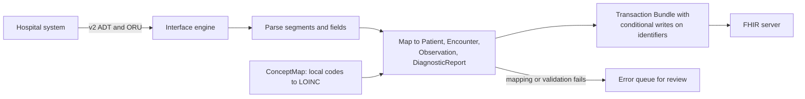

# Module 8: Architecture and design questions

## Concepts

### What a design question tests

Modules 1 to 7 covered facts. Many technical interviews also ask an open question such as
"design a system that gets lab results from three hospitals into our app". There is no
single right answer. The interviewer is checking whether you ask about the requirements,
pick the right FHIR pieces, and name the problems that come up in real projects.

### A method for answering

Work through these steps out loud, in order. Saying each step's name helps the
interviewer follow you.

1. **Clarify.** Who are the users? Is a person present (an app) or not (a backend job)?
   How many patients? How fresh must the data be? Which systems are on the other side,
   and which FHIR version and guides do they support?
2. **Actors and data.** List the systems involved and the resources that move between
   them (module 2).
3. **Access pattern.** Choose among: REST read and search (module 3), bulk export,
   CDS Hooks or subscriptions (module 6), or messages and documents.
4. **Security.** Choose the SMART flow: EHR launch, standalone launch, or Backend Services
   (module 5). State the narrowest scopes.
5. **Data quality.** Say how you handle missing elements, code mapping, duplicates, and
   profile validation (modules 2 and 4).
6. **Failure and scale.** Paging, rate limits, retries, timeouts, partial failures.
7. **Trade-offs.** Say what you chose against and why.

## Worked question 1: a patient app that collects records from several health systems

**Clarify.** A patient uses a phone app. They have visited three health systems, each with
a certified EHR. They want their medications, allergies, problems and lab results in one
list, updated daily.

**Actors and data.** The app, its own backend server, and each health system's FHIR
server. Resources: Patient, MedicationRequest, AllergyIntolerance, Condition, Observation
(laboratory), plus DiagnosticReport.

**Access pattern.** REST search per patient, scoped to the patient (module 3). Each
health system's certified API must follow US Core (module 7), so the same searches should
work on each, with differences.

**Security.** A **standalone launch** (module 5): the patient chooses a health system, logs
in at that system's portal, and approves the app. Scopes such as
`launch/patient openid fhirUser offline_access patient/MedicationRequest.rs patient/AllergyIntolerance.rs patient/Condition.rs patient/Observation.rs`.
`offline_access` gives a refresh token so the backend can update daily without the
patient logging in again. The app's backend should be a confidential client so it can
hold refresh tokens securely; a phone-only design would be a public client with PKCE.

**Finding servers.** The app needs each health system's FHIR base URL. Large EHR vendors
publish lists of their customers' endpoints; the app keeps a directory of them.

**Data quality.**
- The same medication appears from two systems. De-duplicate by comparing codes
  (`system` plus `code`, such as RxNorm), not display text.
- The patient's `id` differs on each server. Keep each server's `id` separately and link
  them to one app user; do not try to match on `id`.
- Expect missing elements and partial dates.
- Each record's `meta.source` or the server it came from must be kept, so the app can
  show where data came from.

**Failure and scale.** Follow `next` links. Respect rate limits. Refresh tokens can be
revoked; the app must ask the patient to reconnect when that happens.

**Trade-off to mention.** Searching everything daily is simple but wasteful. Using
`_lastUpdated` to fetch only changed records reduces load, but not every server supports
it reliably, so check each CapabilityStatement.

## Worked question 2: a nightly export from an EHR to an analytics warehouse

**Clarify.** A hospital wants a data warehouse of all its patients, refreshed nightly.
No user is present.

**Access pattern.** **Bulk Data** Group-level `$export` (module 6), with `_type` listing
the needed resources and `_since` set to the previous run's `transactionTime` for
incremental exports.

**Security.** **SMART Backend Services** with a registered public key and `system/`
scopes, such as `system/Patient.rs system/Observation.rs`.

**Loading.** Download NDJSON files and load them line by line into storage. Flatten them
into tables with SQL on FHIR ViewDefinitions or custom code (module 6).

**Data quality and failure.**
- Read the `error` files in the manifest and report them.
- Incremental exports include updated records; the loader must replace older versions
  by `id`, not add duplicates.
- Deleted records are a known gap: an incremental export may not report deletions, so
  plan a periodic full export to reconcile. Check whether the server's Bulk Data version
  supports reporting deletions.
- The export can take hours; poll politely using `Retry-After`.

**Privacy.** The warehouse holds protected health information and needs access controls,
encryption and audit logging. Consider removing identifiers for research uses.

## Worked question 3: converting an HL7 v2 feed into FHIR

**Clarify.** A hospital sends HL7 v2 admission, discharge and transfer messages (called
ADT messages) and lab result messages (ORU). We need FHIR resources on a FHIR server.

**Design.**
- An **interface engine** (software that receives, transforms and routes healthcare
  messages; Mirth Connect and Rhapsody are common ones) receives the v2 messages.
- A mapping turns each message into resources: ADT into Patient and Encounter; ORU into
  Observation and DiagnosticReport. HL7 publishes a v2-to-FHIR mapping guide that can be
  the starting point.
- Local codes are mapped to standard ones (lab codes to LOINC) using a ConceptMap
  (module 4).
- Resources are written with **conditional update** on business identifiers (module 3),
  such as `PUT Patient?identifier=<mrn system>|<mrn>`. This makes processing **idempotent**,
  meaning that processing the same message twice gives the same result. That matters
  because message feeds resend messages.
- Related records are sent as a **transaction** Bundle so that a Patient and its
  Encounter are created together or not at all.
- Messages that fail mapping or validation go to an error queue for a person to review,
  rather than being dropped.

**Trade-offs.** v2 messages arrive in order; if they are processed in parallel, an older
update can overwrite a newer one. Either process per patient in order, or compare message
timestamps before writing.

[apps/v2-to-fhir](../apps/v2-to-fhir/src/convert.ts) implements the parse and map steps
for one ORU message: `pnpm --filter v2-to-fhir demo`. It uses conditional create
(`ifNoneExist`) on the MRN rather than conditional update.

## Worked question 4: prior authorization inside the EHR

Module 7 gives the answer outline: CRD at order time through CDS Hooks, DTR as a SMART app
that fills in the payer's questionnaire, PAS to submit. Add these details:

- The CRD service must answer fast, so it relies on prefetch (module 6).
- DTR uses the Questionnaire and QuestionnaireResponse resources, and can pre-fill answers
  from the patient record.
- The payer side must meet the CMS decision timeframes in module 7.

## Worked question 5: a CDS service that is too slow

**Problem.** An EHR reports that your `order-sign` service times out.

**Answer outline.**
- Check whether the service makes FHIR requests during the hook call. Move them into
  `prefetch` so the EHR sends the data with the request (module 6).
- Cache reference data, such as drug interaction tables, in memory.
- Set your own time limit and return `{ "cards": [] }` if it is reached; an empty card
  list is a valid response, while an error looks like a broken service.
- Measure response times per hook.

## Real-world problems to mention in any design answer

These come up often in practice. Naming one or two in an answer shows experience.

- **Servers differ.** Each vendor supports a different subset. Read the CapabilityStatement
  and test against each vendor's sandbox.
- **Patient matching.** There is no national patient ID in the US. Matching uses
  demographics and identifiers, and `$match` where supported.
- **Codes.** Local codes are common. Mapping them is ongoing work.
- **Paging and rate limits.** Covered in module 3.
- **Time zones and partial dates.** `dateTime` values may lack a time zone or be partial.
- **Status fields.** Filter out `entered-in-error` and check other modifier elements
  (module 2).
- **Versions.** A partner may run STU3 or DSTU2. Version translation is possible but lossy.

## The ecosystem, by name

You do not need to know these deeply, but recognizing them helps.

| Name | What it is |
|---|---|
| Epic, Oracle Health (formerly Cerner) | The largest US EHR vendors; both offer FHIR R4 APIs and developer sandboxes |
| HAPI FHIR | Open-source Java FHIR server and library; also the public test server used in this course |
| Firely | .NET FHIR library and server |
| Microsoft Azure Health Data Services, Google Cloud Healthcare API, AWS HealthLake | Cloud-hosted FHIR servers |
| Medplum, Aidbox | Commercial FHIR platforms |
| fhirclient (SMART) | JavaScript library for SMART launch, used in this repo |
| Synthea | Generator of synthetic (made-up) patient records |
| Inferno | ONC's open-source test suite for (g)(10) and other guides |
| HL7 FHIR Validator | The reference validator (module 4) |
| Mirth Connect, Rhapsody | Interface engines |

## Try it

Pick two worked questions. Cover the answer, set a timer for ten minutes, and answer out
loud using the seven-step method. Then compare with the written answer and note what you
missed.

## Check yourself

1. What are the seven steps of the design method?
2. When would you choose Backend Services over a standalone launch?
3. Why is conditional update useful when converting v2 messages?
4. What does idempotent mean, and why does it matter for message feeds?
5. Why does an incremental bulk export not fully solve deletions?
6. Name three real-world problems you would raise in any FHIR design.
